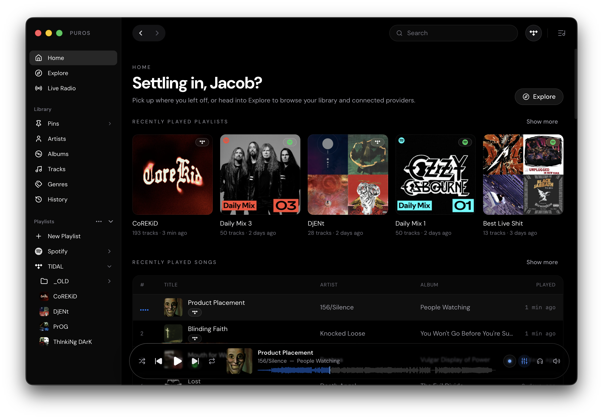

# Puros

**A macOS music player built for audio quality.**

Puros is a music player for people who care about sound, focus, and owning their library. It brings local playback and streaming together in one focused desktop app: see exactly what format is playing, control how your output device is driven, and keep a clean library without the clutter of a general-purpose streaming client.

Website: [getpuros.app](https://getpuros.app) · Discord: [join the community](https://discord.gg/AauwQm2fKe)



## Download

Compiled versions of Puros are published on the [Releases](https://github.com/purosapp/purosapp/releases) page of this repository.

**[⬇ Download Puros](https://github.com/purosapp/purosapp/releases)**: the newest version is at the top.

> [!NOTE]
> Puros is in **alpha**. Expect rough edges and missing features, and keep a backup of anything important. Builds are for Apple Silicon Macs, signed with a Developer ID and notarized by Apple.

Download the `.dmg`, open it and drag Puros to Applications.

## Features

### Playback

- CoreAudio exclusive mode for supported DACs and interfaces, with shared-mode fallback
- Per-device audio setup, including Bluetooth and AirPlay-aware routing
- Resampling with SoX (libsoxr), integer-ratio FIR filters or Apple CoreAudio, or none at all
- Format badges for sample rate, bit depth, bitrate, DSD and MQA

### Library

- Local file scanning with full metadata indexing, and M3U playlists
- Queue, shuffle and now-playing controls
- Artist and album pages, genres, pins and listening history
- Live radio: browse Radio Browser stations or add your own streams

### Sound and extras

- Parametric EQ with AutoEQ presets
- VST and VST3 effects
- MilkDrop-style visualizer
- Last.fm scrobbling and Discord Rich Presence

## Streaming integrations

Streaming services connect through **providers**: separate packages you install from **Settings → Accounts → Install provider…**. Puros keeps the library, queue, decoding, DSP and output; a provider handles sign-in, the service's catalog and preparing audio files.

Unofficial providers (SoundCloud, Spotify, TIDAL, YouTube Music and more) are listed in **[purosapp/providers-list](https://github.com/purosapp/providers-list)**. They are third-party software, not part of Puros, and Puros is not responsible for them.

Want to build one? Start with the **[Provider SDK](https://github.com/purosapp/puros-provider-sdk)**.

## Requirements

- A Mac with Apple Silicon
- A CoreAudio-compatible output device
- An account for any streaming service you connect (optional)

## Building from source

You need macOS, Node.js, the Xcode Command Line Tools (`xcode-select --install`) and CMake (`brew install cmake`) for the native audio engine.

The Provider SDK and the providers are separate repositories cloned into this checkout. Clone them before `npm install`, because the SDK is linked as `file:provider-sdk`:

```sh
git clone https://github.com/purosapp/purosapp.git puros
cd puros
npm run repos:clone     # provider-sdk, providers-list and the providers in repos.json
npm install
npm run build:native    # libsoxr + the CoreAudio addon
npm run dev
```

Optional settings (Last.fm, Discord Rich Presence) go in a `.env` copied from [`.env.example`](.env.example); it is ignored by git. Without them those integrations show as unconfigured.

```sh
npm test                # unit tests
npm run typecheck
npm run check:all       # the full automated gate matrix
npm run build           # unsigned local DMG in release/
```

Release builds include no streaming providers unless `PUROS_PROVIDERS` is set, for example `PUROS_PROVIDERS=tidal npm run build`. Working on providers inside this checkout is covered in [docs/provider-plugins/AUTHORING.md](docs/provider-plugins/AUTHORING.md).

## Contributing

Issues and pull requests are welcome. For bigger changes, come say hi on [Discord](https://discord.gg/AauwQm2fKe) or open an issue first so we can agree on the approach. Changes to the provider contract belong in the [Provider SDK](https://github.com/purosapp/puros-provider-sdk); changes to a provider belong in that provider's repository.

## License

Puros is free software, licensed under the [GNU General Public License v3.0](LICENSE).

The Provider SDK and the providers are separate projects under their own licenses (MIT). Bundled third-party components keep their licenses: libsoxr (LGPL-2.1, linked as a separate dynamic library) and the VST3 SDK interfaces (MIT, [`native/vendor/vst3sdk-interfaces`](native/vendor/vst3sdk-interfaces/LICENSE.txt)).
